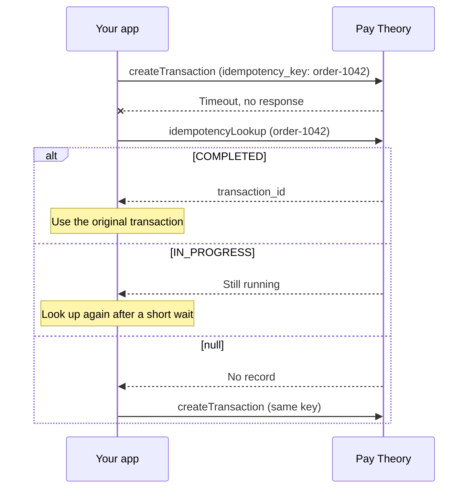

# Idempotency

An idempotency key lets you retry a payment without charging twice. Send a key with the payment, and Pay Theory creates at most one transaction or authorization for that key. If you're not sure the first request went through, look the key up and get the original payment back.

Keys work the same way from the JS SDK and the API.

***

## When you need a key

Some failures leave you unsure whether a payment happened:

- The request times out after Pay Theory received it.
- The payor's connection drops before your page gets the response.
- The payor clicks Pay twice, or your code retries automatically.

Without a key, a retry creates a second payment. With a key, Pay Theory rejects the retry and you can look up the payment the first request created.

***

## How keys work

Pay Theory tracks each key per merchant and operation. The operation is `CREATE_TRANSACTION` or `CREATE_AUTHORIZATION`, so one merchant can use the same key once for a transaction and once for an authorization. Two merchants never share a key's record.

| Stage | What Pay Theory does |
|-------|----------------------|
| First request | Reserves the key with status `IN_PROGRESS`, then runs the payment. |
| Payment created | Sets the status to `COMPLETED` and links the transaction or authorization. This happens for a declined payment too. |
| Request with a used key | Returns the original payment's ID instead of creating a new one. |
| 7 days after the first request | Deletes the record. A lookup returns `null`, and the key can create a new payment. |

A key is any string that isn't empty or only spaces. Pay Theory trims spaces from the ends. Use one key per payment attempt, such as your order ID, and send the same key on every retry of that attempt.

A declined payment uses up its key. To retry a declined card, or to let the payor try another card, send a new key.

:::note Same key, different request
If you reuse a key with any change to the request, such as a different amount, payment method, payor or metadata, Pay Theory rejects it with `IDEMPOTENCY_KEY_PAYLOAD_MISMATCH`. For 7 days, a key belongs to the first request that used it.
:::

***

## 1. Send a key with the payment

From the JS SDK, pass `idempotencyKey` to [`transact`](../../sdk/javascript/functions#transact):

```javascript title="javascript"
const result = await paytheory.transact({
  amount: 250,
  idempotencyKey: 'order-1042',
})
```

From the API, pass `idempotency_key` to `createTransaction` or `createAuthorization`:

```graphql title="Example mutation"
mutation CreateTransaction(
  $merchant_uid: String!
  $amount: Int!
  $idempotency_key: String
  $payment_method_id: String
) {
  createTransaction(
    merchant_uid: $merchant_uid
    amount: $amount
    idempotency_key: $idempotency_key
    payment_method_id: $payment_method_id
  ) {
    transaction_id
    status
    gross_amount
  }
}
```

```json title="Variables"
{
  "merchant_uid": "e9f2387b-8727-450a-w3g2-fee9b49e42a1",
  "amount": 250,
  "idempotency_key": "order-1042",
  "payment_method_id": "ptl_pmt_54LidQwRcTs5MU9g0QYrgt"
}
```

Store the key with your order before you send the request. If the request fails, you need the key to retry or to look the payment up.

***

## 2. Handle a used key

When a key has already created a transaction, Pay Theory doesn't create another one.

The API returns a `CONFLICT` error, and its `data` has the `transaction_id` of the original transaction:

```json title="Response"
{
  "data": null,
  "errors": [
    {
      "errorType": "CONFLICT",
      "data": {
        "transaction_id": "ptl_txn_5mos8Z6NFWAWQRac7BAQFX"
      }
    }
  ]
}
```

A retried `createAuthorization` returns the original authorization instead of an error.

The JS SDK returns an `ERROR` response. Its message includes the error code and the original `transaction_id`:

```javascript title="javascript"
if (result.type === 'ERROR') {
  if (result.error.includes('IDEMPOTENCY_KEY_ALREADY_USED')) {
    // This attempt already ran. Look up the payment instead of charging again.
  } else if (result.error.includes('IDEMPOTENCY_KEY_PAYLOAD_MISMATCH')) {
    // The key was used for a different request. Send a new key.
  }
}
```

In both cases the payor isn't charged again. Use the original payment, or look it up as in the next step.

***

## 3. Look up a key after a timeout

If you never got a response, call [`idempotencyLookup`](../../api/idempotency/idempotency-lookup) with the merchant, the operation and the key. It's an API query, so a JS SDK integration calls it from your server.

```graphql title="Example query"
query IdempotencyLookup(
  $merchant_uid: String!
  $operation: IdempotencyOperation!
  $idempotency_key: String!
) {
  idempotencyLookup(
    merchant_uid: $merchant_uid
    operation: $operation
    idempotency_key: $idempotency_key
  ) {
    idempotency_status
    transaction_id
    authorization_id
    locked_until
    expires_at
  }
}
```

```json title="Variables"
{
  "merchant_uid": "e9f2387b-8727-450a-w3g2-fee9b49e42a1",
  "operation": "CREATE_TRANSACTION",
  "idempotency_key": "order-1042"
}
```

```json title="Response"
{
  "data": {
    "idempotencyLookup": {
      "idempotency_status": "COMPLETED",
      "transaction_id": "ptl_txn_5mos8Z6NFWAWQRac7BAQFX",
      "authorization_id": null,
      "locked_until": "2026-09-02T21:25:54.494Z",
      "expires_at": "2026-09-09T20:55:54.494Z"
    }
  }
}
```

To get the whole transaction or authorization in the same request, add the `transaction` or `authorization` field to the query.

Act on the result:

| Result | What it means | What to do |
|--------|---------------|------------|
| `COMPLETED` | The payment was created. It may have succeeded or been declined. | Use `transaction_id` or `authorization_id` and check its status. Retry a decline with a new key. |
| `IN_PROGRESS` | Pay Theory started the payment and hasn't finished it. | Look the key up again after a short wait. The key stays reserved until `expires_at`, so a retry with the same key can't create a second payment. |
| `null` | Pay Theory has no record of the key, or the record expired after 7 days. | If the request was in the last 7 days, no payment was created. Retry with the same key. |

***

## The full retry flow



***

## Related

- [`transact`](../../sdk/javascript/functions#transact) in the JS SDK reference
- [`createTransaction`](../../api/transaction/create-transaction) and [`createAuthorization`](../../api/authorization/create-authorization) in the API reference
- [Failure codes](../after_payments/failed_transactions). A processor's `DUPLICATE_TRANSACTION` decline is a different check: the processor declines a payment that matches a recent one in amount and payment method, with or without a key.
