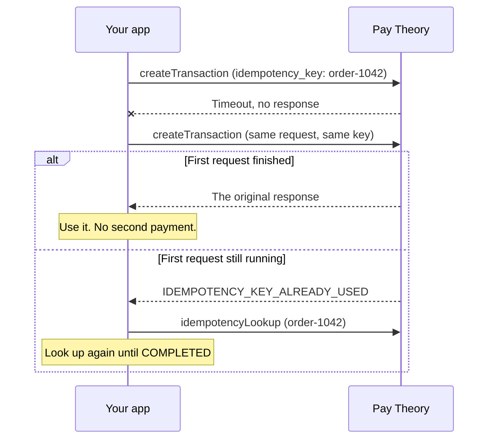

# Idempotency

An idempotency key makes a payment safe to retry. Send a key with a payment, and Pay Theory processes it once. If the same request arrives again with the same key, Pay Theory returns the first response instead of charging again, whether that was a transaction, a decline or an error.

Keys work the same way from the JS SDK and the API.

***

## When you need a key

Some failures leave you unsure whether a payment happened:

- The request times out after Pay Theory received it.
- The payor's connection drops before your page gets the response.
- The payor clicks Pay twice, or your code retries automatically.

Without a key, a retry creates a second payment. With a key, the retry gets back the result of the first payment.

***

## How keys work

Pay Theory tracks each key per merchant and operation. The operation is `CREATE_TRANSACTION` or `CREATE_AUTHORIZATION`, so one merchant can use the same key once for a transaction and once for an authorization. Two merchants never share a key's record.

| Request | What Pay Theory returns |
|---------|-------------------------|
| First request with a key | Runs the payment and saves the response. |
| Same request, same key | The saved response from the first request. No new payment is created. |
| Changed request, same key | An `IDEMPOTENCY_KEY_PAYLOAD_MISMATCH` error with the original `transaction_id` or `authorization_id`. |
| Same key while the first request is still running | An `IDEMPOTENCY_KEY_ALREADY_USED` error with the first request's `transaction_id` or `authorization_id`. |
| Any request 7 days after the first | Pay Theory has deleted the record, so the key creates a new payment. |

A changed request is any difference in what you send, such as the amount, payment method, payor, metadata or reference.

A key is any string that isn't empty or only spaces. Pay Theory trims spaces from the ends. Use one key per payment attempt, such as your order ID, and send the same key on every retry of that attempt.

A declined payment is a saved response too. Retrying it with the same key returns the same decline. To let the payor try another card, send a new key.

:::note Retry from where you started
The JS SDK and the API fingerprint requests differently. A key first used from the SDK returns `IDEMPOTENCY_KEY_PAYLOAD_MISMATCH` when you send it from the API, and the reverse. Retry from the same place you made the first request.
:::

***

## 1. Send a key with the payment

From the JS SDK, pass `idempotencyKey` to [`transact`](../../sdk/javascript/functions#transact):

```javascript title="javascript"
const result = await paytheory.transact({
  amount: 250,
  idempotencyKey: 'order-1042',
})
```

From the API, pass `idempotency_key` to `createTransaction` or `createAuthorization`:

```graphql title="Example mutation"
mutation CreateTransaction(
  $merchant_uid: String!
  $amount: Int!
  $idempotency_key: String
  $payment_method_id: String
) {
  createTransaction(
    merchant_uid: $merchant_uid
    amount: $amount
    idempotency_key: $idempotency_key
    payment_method_id: $payment_method_id
  ) {
    transaction_id
    status
    gross_amount
  }
}
```

```json title="Variables"
{
  "merchant_uid": "e9f2387b-8727-450a-w3g2-fee9b49e42a1",
  "amount": 250,
  "idempotency_key": "order-1042",
  "payment_method_id": "ptl_pmt_54LidQwRcTs5MU9g0QYrgt"
}
```

Store the key with your order before you send the request. If the request fails, you need the key to retry or to look the payment up.

***

## 2. Retry with the same key

Send the same request with the same key. You get the first response back.

From the API, a retried `createTransaction` or `createAuthorization` returns the original transaction or authorization, exactly as the first request did.

From the JS SDK, `transact` resolves to the original `SUCCESS`, `FAILED` or `ERROR` response. After a page reload, the payor needs to enter the same card or bank details, and you need to pass the same amount and payor details. Otherwise the retry counts as a changed request.

If the request changed, or the first request is still running, `transact` returns an `ERROR`. The message includes the error code and the original `transaction_id`:

```text title="Error message"
SOCKET_ERROR: CONFLICT: Idempotency key was already used with a different request payload., {'error_code': 'IDEMPOTENCY_KEY_PAYLOAD_MISMATCH', 'idempotency_status': 'COMPLETED', 'operation': 'CREATE_TRANSACTION', 'transaction_id': 'ptl_txn_5mos8Z6NFWAWQRac7BAQFX', ...}
```

```javascript title="javascript"
if (result.type === 'ERROR') {
  if (result.error.includes('IDEMPOTENCY_KEY_PAYLOAD_MISMATCH')) {
    // This key belongs to a different request. Send a new key for a new payment.
  } else if (result.error.includes('IDEMPOTENCY_KEY_ALREADY_USED')) {
    // The first attempt is still running. Look the key up before you retry.
  }
}
```

The API returns the same conflicts as a `CONFLICT` error. `errorInfo.details` holds the error code, the status of the first request and its `transaction_id` or `authorization_id`:

```json title="Response"
{
  "data": null,
  "errors": [
    {
      "path": ["createTransaction"],
      "data": null,
      "errorType": "CONFLICT",
      "errorInfo": {
        "code": "CONFLICT",
        "details": {
          "error_code": "IDEMPOTENCY_KEY_PAYLOAD_MISMATCH",
          "idempotency_status": "COMPLETED",
          "merchant_uid": "e9f2387b-8727-450a-w3g2-fee9b49e42a1",
          "operation": "CREATE_TRANSACTION",
          "transaction_id": "ptl_txn_5mos8Z6NFWAWQRac7BAQFX"
        }
      },
      "message": "Idempotency key was already used with a different request payload."
    }
  ]
}
```

An `IDEMPOTENCY_KEY_ALREADY_USED` error can have an `idempotency_status` of `COMPLETED` when the first request finished while yours was being checked. Retry with the same key to get its response.

***

## 3. Look up a key after a timeout

To check on a payment without retrying it, call [`idempotencyLookup`](../../api/idempotency/idempotency-lookup) with the merchant, the operation and the key. It's an API query, so a JS SDK integration calls it from your server.

```graphql title="Example query"
query IdempotencyLookup(
  $merchant_uid: String!
  $operation: IdempotencyOperation!
  $idempotency_key: String!
) {
  idempotencyLookup(
    merchant_uid: $merchant_uid
    operation: $operation
    idempotency_key: $idempotency_key
  ) {
    idempotency_status
    transaction_id
    authorization_id
    locked_until
    expires_at
  }
}
```

```json title="Variables"
{
  "merchant_uid": "e9f2387b-8727-450a-w3g2-fee9b49e42a1",
  "operation": "CREATE_TRANSACTION",
  "idempotency_key": "order-1042"
}
```

```json title="Response"
{
  "data": {
    "idempotencyLookup": {
      "idempotency_status": "COMPLETED",
      "transaction_id": "ptl_txn_5mos8Z6NFWAWQRac7BAQFX",
      "authorization_id": null,
      "locked_until": "2026-09-02T21:25:54.494Z",
      "expires_at": "2026-09-09T20:55:54.494Z"
    }
  }
}
```

To get the whole transaction or authorization in the same request, add the `transaction` or `authorization` field to the query.

| Result | What it means | What to do |
|--------|---------------|------------|
| `COMPLETED` | The payment ran. It may have succeeded or been declined. | Use `transaction_id` or `authorization_id` and check its status. A retry with the same key returns the same result. |
| `IN_PROGRESS` | Pay Theory started the payment and hasn't saved a response yet. | Look the key up again after a short wait. Until it completes, a retry returns `IDEMPOTENCY_KEY_ALREADY_USED`. |
| `null` | Pay Theory has no record of the key, or the record expired after 7 days. | If the request was in the last 7 days, no payment was created. Retry with the same key. |

***

## The full retry flow



***

## Related

- [`transact`](../../sdk/javascript/functions#transact) in the JS SDK reference
- [`createTransaction`](../../api/transaction/create-transaction) and [`createAuthorization`](../../api/authorization/create-authorization) in the API reference
- [Failure codes](../after_payments/failed_transactions). A processor's `DUPLICATE_TRANSACTION` decline is a different check: the processor declines a payment that matches a recent one in amount and payment method, with or without a key.
